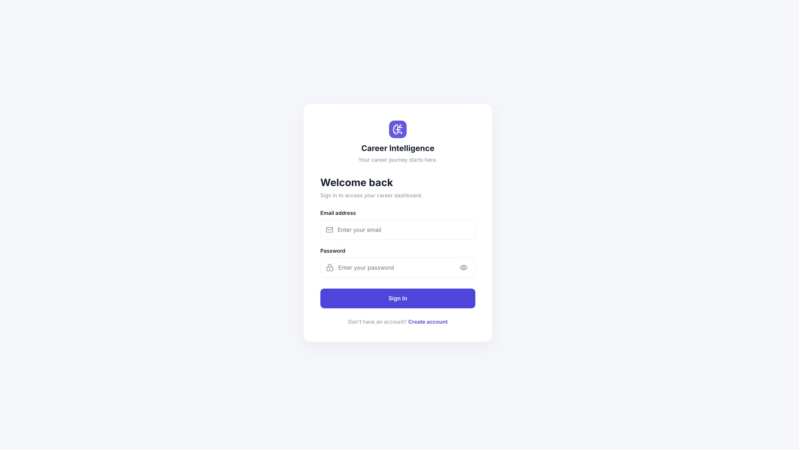
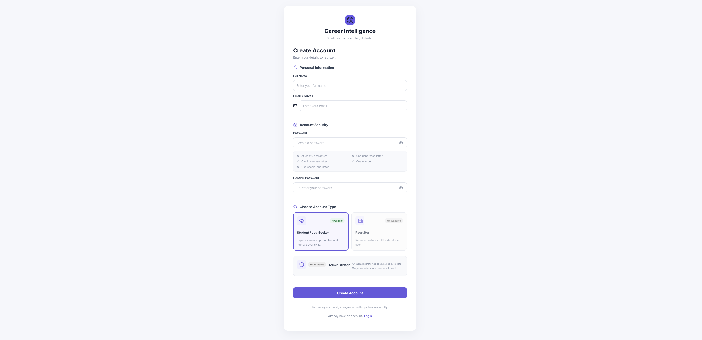
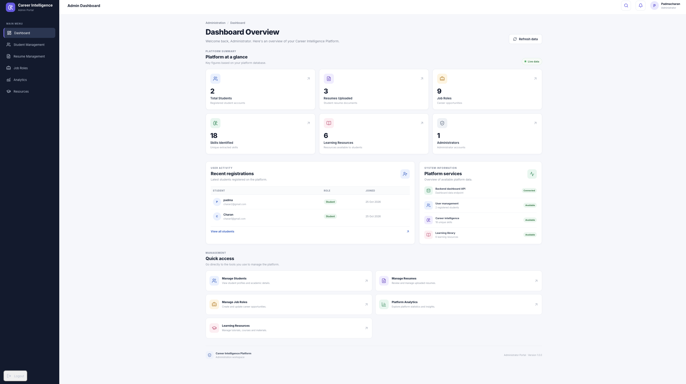
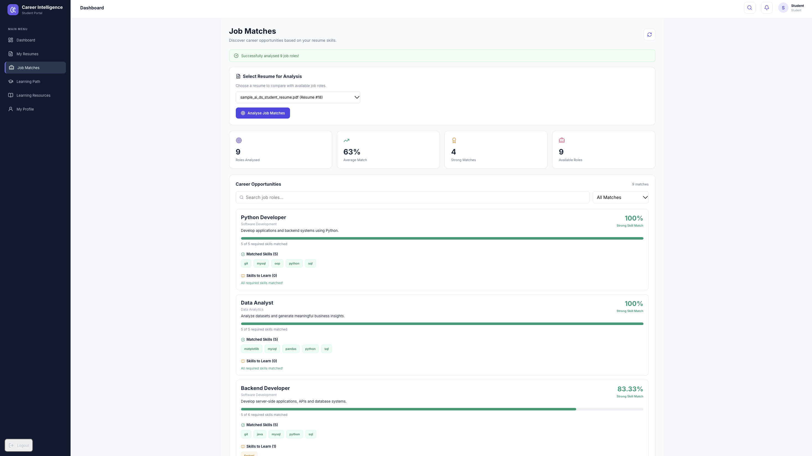
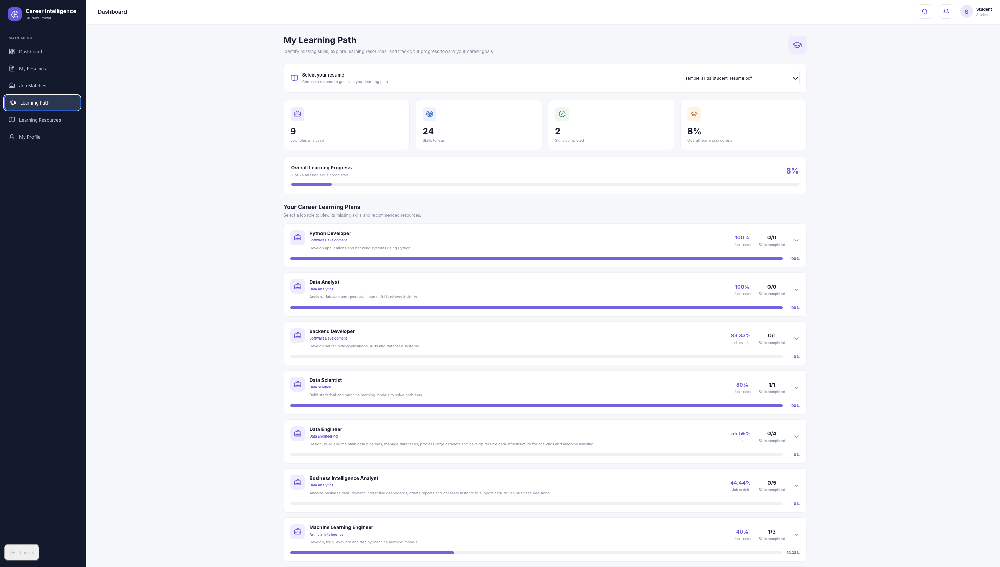

# AI Career Intelligence Platform

An AI-powered career guidance platform that helps students analyze their resumes, identify skill gaps, explore suitable job roles, and follow personalized learning paths.

## Project Overview

The AI Career Intelligence Platform is a full-stack web application designed to help students understand their career readiness.

Students can upload their resumes, extract technical skills, compare their skills with different job roles, identify missing skills, and access personalized learning recommendations.

Administrators can manage students, resumes, job roles, learning resources, and platform analytics through a dedicated admin dashboard.

## Problem Statement

Many students struggle to understand whether their current skills match industry job requirements.

They often do not know:

- Which job roles match their existing skills.
- Which technical skills they are missing.
- What they should learn next.
- How to track their learning progress.
- How prepared they are for their desired career roles.

This platform addresses these challenges through resume analysis, job-role matching, skill-gap analysis, and personalized learning recommendations.

## Key Features

### 1. Student Module

- **Student Registration and Login** – Secure account creation and login.
- **JWT Authentication** – Token-based authentication for protected access.
- **Resume Upload** – Upload resumes in PDF format.
- **Resume Text Extraction** – Extract text from uploaded PDF resumes.
- **Automatic Skill Extraction** – Identify technical skills from resume content.
- **Job Role Matching** – Match student skills against different job roles.
- **Skill Gap Analysis** – Identify missing skills required for selected job roles.
- **Personalized Learning Recommendations** – Suggest skills and learning resources based on identified skill gaps.
- **Student Dashboard** – View career-related statistics, extracted skills, job matches, and recent resume activity.
- **Learning Path Generation** – View recommended learning paths based on skill gaps.
- **Learning Progress Tracking** – Track learning progress and completion.
- **My Profile** – View and update personal and academic details.
- **Learning Resources** – Access relevant learning materials.
- **Resume History** – View previously uploaded resumes and their analysis.

### 2. Admin Module

- **Admin Dashboard** – View platform statistics and activity.
- **Student Management** – View and manage registered student accounts.
- **Student Details** – View individual student information.
- **Resume Management** – View student resumes and their analysis details.
- **PDF Download and Delete** – Download or delete uploaded student resumes.
- **Job Role Management** – Add, view, update, and delete job roles.
- **Learning Resource Management** – Add, view, update, and delete learning resources.
- **Platform Analytics** – View charts and statistics about platform activity.
- **Registration Analytics** – Analyze student registration statistics.
- **Resume Upload Analytics** – Track resume upload activity.
- **Popular Skills Analytics** – Identify frequently extracted skills.
- **Job Role Demand Analytics** – Analyze job-role matching trends.
- **Skill Gap Analytics** – Understand commonly missing skills among students.

### 3. Security and Access Control

- Password hashing using Argon2.
- JWT-based authentication.
- Role-based access control for students and administrators.
- Protected backend API endpoints.
- Environment variables for sensitive configuration.
- Separate student and administrator permissions.

## Application Screenshots

### Login Page



### Registration Page



### Admin Dashboard



### Job Matches



### Learning Path



## Technology Stack

| Area | Technologies |
|---|---|
| Frontend | React.js, JavaScript, HTML5, CSS3 |
| Backend | Python, FastAPI |
| Database | MySQL |
| ORM | SQLAlchemy |
| Authentication | JWT |
| Password Security | Argon2 |
| PDF Processing | Python PDF extraction libraries |
| API Communication | Axios, REST API |
| Charts | Recharts |
| Development Tools | VS Code, Git, GitHub |

## System Architecture

```text
                  STUDENT / ADMIN
                         |
                         v
                  REACT FRONTEND
                         |
                   Axios / REST API
                         |
                         v
                  FASTAPI BACKEND
                         |
           +-------------+-------------+
           |             |             |
           v             v             v
     Authentication   Resume       Job Matching
                      Processing
           |             |             |
           +-------------+-------------+
                         |
                         v
                   MYSQL DATABASE
                         |
                         v
             Learning Recommendations
                         |
                         v
                  REACT FRONTEND
```

## Project Structure

```text
AI-Career-Intelligence-Platform/
|
|-- app/
|   |-- api/
|   |   |-- user.py
|   |   |-- resume.py
|   |   |-- dependencies.py
|   |   |-- job_role.py
|   |   |-- dashboard.py
|   |   |-- admin.py
|   |   |-- learning_path.py
|   |   |-- resource.py
|   |
|   |-- database/
|   |   |-- connection.py
|   |   |-- user_model.py
|   |   |-- resume_model.py
|   |   |-- skill_model.py
|   |   |-- job_role_model.py
|   |   |-- learning_progress_model.py
|   |   |-- resource_model.py
|   |
|   |-- schemas/
|   |   |-- user_schema.py
|   |
|   |-- services/
|   |   |-- security.py
|   |   |-- pdf_extractor.py
|   |   |-- skill_extractor.py
|   |   |-- job_matcher.py
|   |   |-- learning_recommender.py
|   |
|   |-- utils/
|       |-- skill_list.py
|
|-- frontend/
|   |-- public/
|   |-- src/
|   |-- package.json
|
|-- screenshots/
|   |-- login.png
|   |-- register.png
|   |-- admin-dashboard.png
|   |-- job-matches.png
|   |-- learning-path.png
|
|-- uploads/              # Runtime resume uploads (not committed)
|-- venv/                 # Python virtual environment (not committed)
|-- .env                  # Local environment variables (not committed)
|-- .env.example
|-- .gitignore
|-- requirements.txt
|-- README.md
```

## Installation and Setup

Follow these steps to run the project locally.

### 1. Clone the Repository

```bash
git clone https://github.com/padmacharanas/AI-Career-Intelligence-Platform.git

cd AI-Career-Intelligence-Platform
```

### 2. Backend Setup

Create a Python virtual environment:

```bash
python3 -m venv venv
```

Activate the virtual environment on macOS/Linux:

```bash
source venv/bin/activate
```

Install the required Python packages:

```bash
pip install -r requirements.txt
```

### 3. Database Setup

Make sure MySQL Server is installed and running.

Create the project database:

```sql
CREATE DATABASE career_intelligence;
```

Configure your MySQL username and password in the `.env` file.

### 4. Environment Configuration

Create a `.env` file in the project root directory.

Use `.env.example` as a reference.

Example configuration:

```env
APP_NAME=AI Career Intelligence Platform
DEBUG=False

DATABASE_HOST=localhost
DATABASE_PORT=3306
DATABASE_USER=your_database_username
DATABASE_PASSWORD=your_database_password
DATABASE_NAME=career_intelligence

SECRET_KEY=replace_with_a_secure_secret_key
ALGORITHM=HS256
ACCESS_TOKEN_EXPIRE_MINUTES=30
```

Generate a secure secret key using:

```bash
python -c "import secrets; print(secrets.token_urlsafe(32))"
```

Replace the placeholder values with your own local configuration.

**Important:** Never upload your actual `.env` file, database password, or secret key to GitHub.

### 5. Frontend Setup

Open a new terminal and navigate to the frontend directory:

```bash
cd frontend
```

Install frontend dependencies:

```bash
npm install
```

## Running the Application

You need two terminals to run the backend and frontend.

### Terminal 1: Start Backend

From the project root directory, activate the virtual environment:

```bash
source venv/bin/activate
```

Start the FastAPI development server:

```bash
uvicorn app.main:app --reload
```

Backend URL:

http://127.0.0.1:8000

API documentation:

http://127.0.0.1:8000/docs

### Terminal 2: Start Frontend

Navigate to the frontend directory:

```bash
cd frontend
```

Start the React development server:

```bash
npm run dev
```

Frontend URL:

http://localhost:5173

Open the frontend URL in your browser to use the application.

## API Documentation

The backend APIs are built using FastAPI.

Interactive API documentation is available at:

http://127.0.0.1:8000/docs

The API documentation allows developers to explore and test the available endpoints.

## Security Features

- JWT-based authentication.
- Password hashing using Argon2.
- Role-based access control for students and administrators.
- Protected API endpoints.
- Environment-based configuration for sensitive credentials.
- Separation of student and administrator permissions.

## Future Enhancements

- Integration with cloud storage.
- Advanced AI-based resume analysis.
- LLM-powered career guidance.
- Integration with external job portals.
- Recruiter module.
- Advanced career prediction and recommendation features.

## Author

**A S Padmacharan**

B.Tech – Artificial Intelligence and Data Science

Sri Krishna College of Engineering and Technology

Graduation: 2028

GitHub: [padmacharanas](https://github.com/padmacharanas)

LinkedIn: [Padmacharan](https://linkedin.com/in/padmacharan03)

## License

This project is currently shared without an open-source license. All rights are reserved by the author unless otherwise stated.
