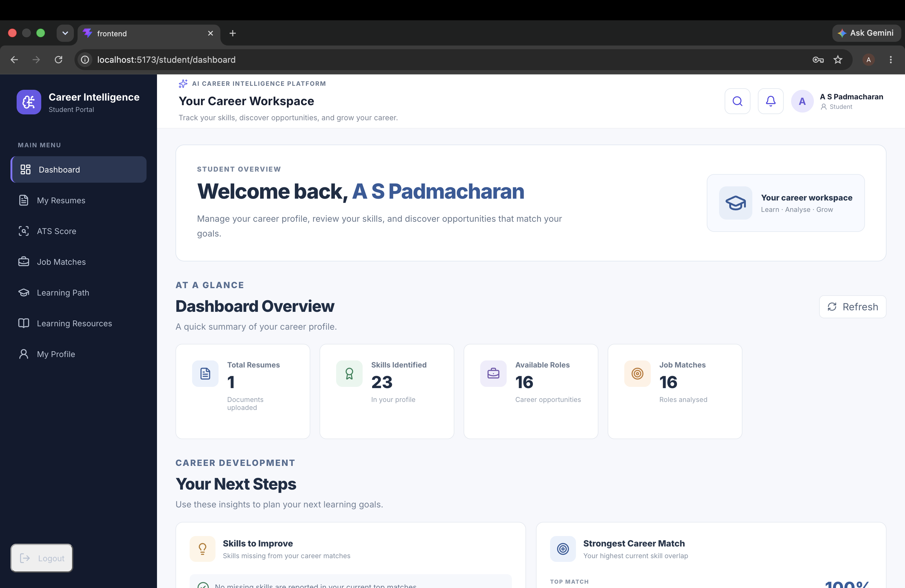
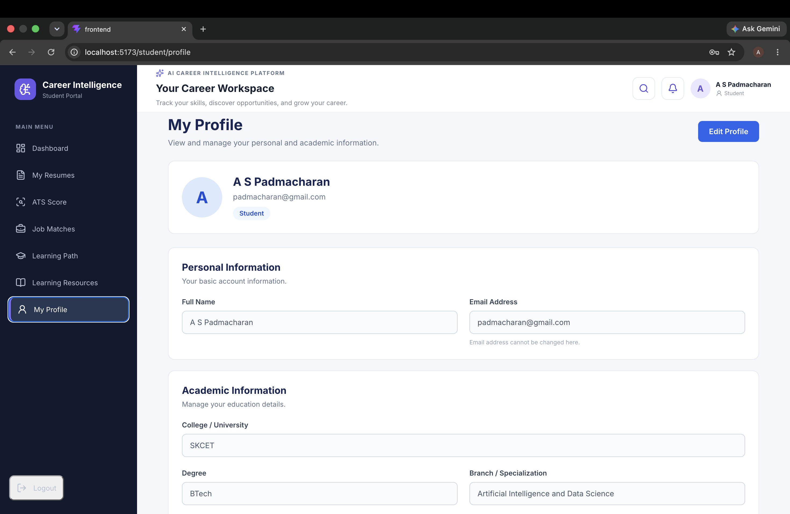
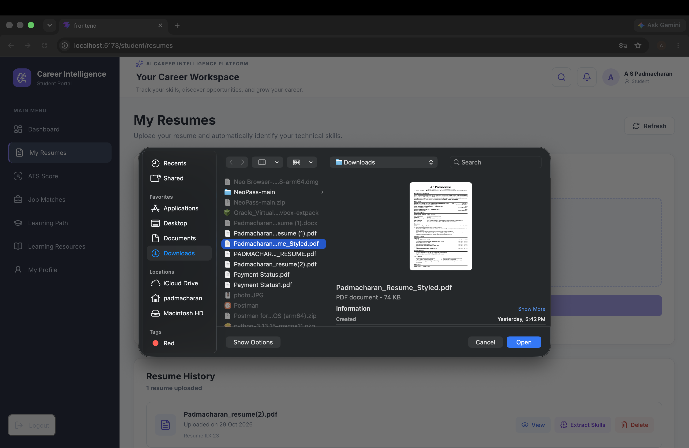
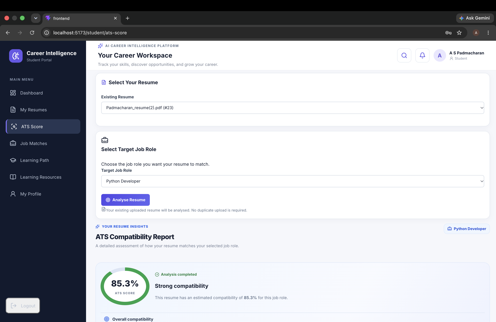
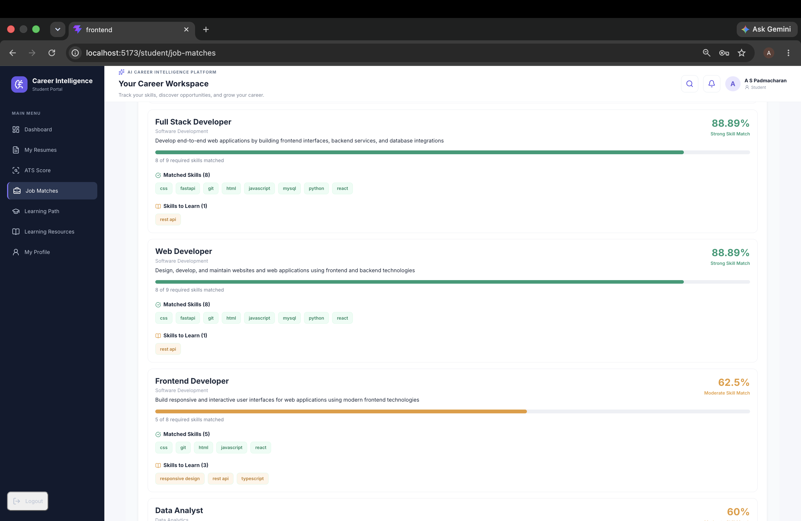
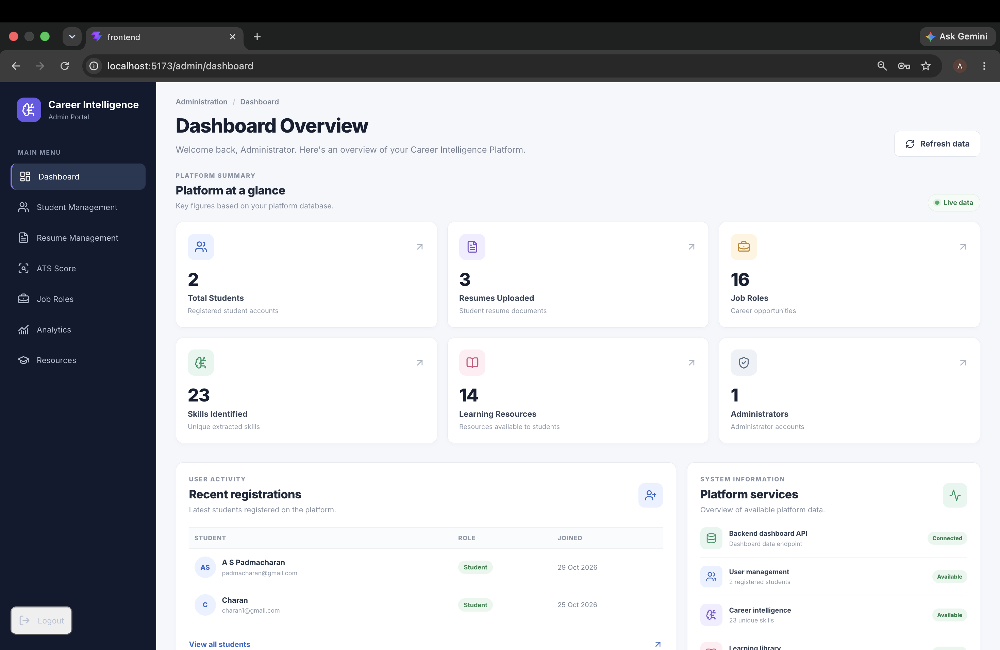
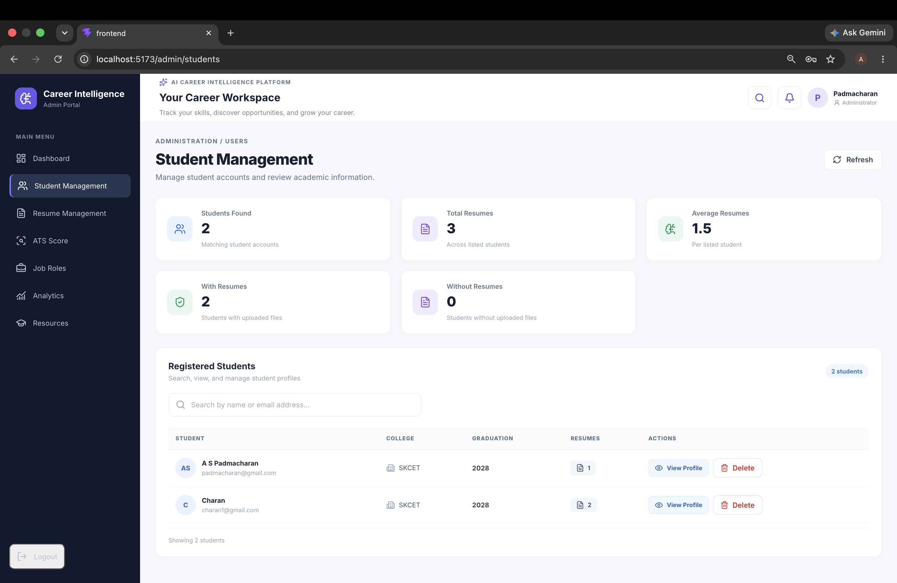
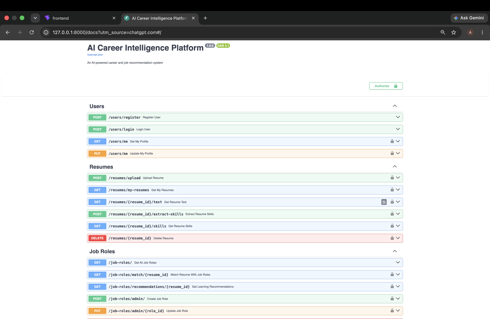

# AI Career Intelligence Platform

An AI-powered career guidance platform that helps students evaluate their career readiness through resume analysis, ATS scoring, technical skill extraction, job-role matching, skill-gap identification, and personalized learning recommendations.

The platform provides a dedicated student portal and an administrative dashboard to manage students, resumes, job roles, learning resources, and platform analytics.

---

## Project Overview

The AI Career Intelligence Platform is a full-stack web application designed to help students understand their career readiness and make informed career decisions.

Students can upload their resumes, extract technical skills, evaluate their resumes against selected job roles, identify missing skills, and explore personalized learning recommendations.

The platform includes an ATS-style resume evaluation system that generates a score out of 100 based on multiple weighted criteria, helping students understand how well their resumes align with job requirements.

Administrators can manage student accounts, resumes, job roles, learning resources, and platform activity through a dedicated admin dashboard.

---

## Problem Statement

Many students struggle to understand whether their existing technical skills and resumes meet industry job requirements.

Common challenges include:

- Identifying suitable job roles based on existing skills.
- Understanding which technical skills are missing.
- Evaluating how well a resume matches a job description.
- Knowing what to improve in a resume.
- Identifying important resume sections and keywords.
- Knowing what to learn next.
- Tracking learning progress.
- Understanding their overall career readiness.

This platform addresses these challenges through resume analysis, ATS scoring, job-role matching, skill-gap analysis, and personalized learning recommendations.

---

## Key Features

### 1. Student Module

- **Student Registration and Login:** Create an account and securely access the platform.
- **JWT Authentication:** Token-based authentication for protected resources.
- **Student Dashboard:** View career-related statistics, extracted skills, job matches, and recent resume activity.
- **Resume Upload:** Upload resumes in PDF format.
- **Resume Text Extraction:** Extract text from uploaded PDF resumes.
- **Automatic Skill Extraction:** Identify technical skills from resume content.
- **Resume Management:** View and manage uploaded resumes.
- **Resume History:** Access previously uploaded resumes and their analysis.
- **ATS Resume Scoring:** Evaluate resume alignment with selected job roles using a weighted scoring system out of 100.
- **ATS Score Breakdown:** View individual scoring contributions from technical skills, job-description keywords, resume content, sentence quality, and education.
- **Matched Skills Analysis:** Identify technical skills already present in the resume.
- **Missing Skills Analysis:** Discover technical skills required by the selected job role but not found in the resume.
- **Keyword Matching:** Identify relevant job-description keywords present or missing in the resume.
- **Resume Content Analysis:** Check for important resume sections such as summary, education, skills, projects, and experience.
- **Sentence Quality Feedback:** Receive suggestions to improve resume readability and presentation.
- **Education Matching:** Evaluate educational qualification alignment with selected job roles.
- **Job Role Matching:** Compare student skills against available job-role requirements.
- **Skill Gap Analysis:** Identify skills that need improvement for selected job roles.
- **Personalized Learning Recommendations:** Recommend learning resources based on identified skill gaps.
- **Learning Path Generation:** View recommended learning paths.
- **Learning Progress Tracking:** Monitor learning progress and completion.
- **My Profile:** View and update personal and academic information.
- **Learning Resources:** Access relevant learning materials.

### 2. ATS Resume Analysis and Scoring

The platform includes an Applicant Tracking System (ATS)-style resume analysis module that evaluates how well a student's resume aligns with a selected job role.

The ATS engine analyzes resume content, technical skills, job-description keywords, sentence quality, and educational qualifications to generate an overall score out of 100.

#### ATS Score Calculation

The ATS score is calculated using five weighted components:

| Scoring Component | Weight |
|---|---:|
| Technical Skills Matching | 40% |
| Job Description Keyword Matching | 30% |
| Resume Content Analysis | 15% |
| Sentence Quality Analysis | 10% |
| Education Qualification Matching | 5% |
| **Total** | **100%** |

#### 1. Technical Skills Matching — 40%

- Extracts technical skills from uploaded resume content.
- Compares extracted skills with the selected job role's required skills.
- Identifies matched technical skills.
- Identifies missing technical skills.
- Calculates the technical skill-matching contribution.

#### 2. Job Description Keyword Matching — 30%

- Evaluates relevant keywords in the resume against the selected job role.
- Identifies matched keywords.
- Identifies missing keywords.
- Measures how closely the resume content aligns with job requirements.

#### 3. Resume Content Analysis — 15%

- Evaluates the presence of important resume sections.
- Checks for sections such as professional summary, education, skills, projects, and experience.
- Provides feedback about missing or incomplete sections.

#### 4. Sentence Quality Analysis — 10%

- Evaluates sentence quality in resume content.
- Identifies sentence-related issues.
- Provides suggestions to improve resume readability and presentation.

#### 5. Education Qualification Matching — 5%

- Evaluates educational qualifications against job-role requirements.
- Provides feedback about qualification alignment.

#### ATS Analysis Report

After analysis, the platform generates a detailed report containing:

- Overall ATS score out of 100.
- Individual scoring contributions.
- Technical skills matched.
- Technical skills missing.
- Matched job-description keywords.
- Missing job-description keywords.
- Detected resume sections.
- Missing resume sections.
- Sentence-quality feedback.
- Education qualification feedback.
- Suggestions to improve resume alignment.
- Learning recommendations for identified skill gaps.

#### Student and Admin ATS Access

- Students can analyze their uploaded resumes against available job roles.
- Administrators can access ATS analysis functionality through the admin module.
- Both modules use the same ATS scoring engine.
- Missing skills are identified using the skills configured for the selected job role by the administrator.
- Previous ATS analysis results can be accessed through analysis history.

**Important:** The ATS score is a rule-based resume evaluation score. It provides guidance on resume alignment and does not guarantee selection by an employer or a particular external ATS platform.

### 3. Admin Module

- **Admin Dashboard:** View platform statistics and activity.
- **Student Management:** View and manage registered student accounts.
- **Student Details:** View individual student information.
- **Student Profile Editing:** Update student information.
- **Resume Management:** View student resumes and their analysis details.
- **PDF Download:** Download uploaded student resumes.
- **Resume Deletion:** Delete uploaded student resumes.
- **Admin ATS Analysis:** Access resume analysis functionality through the admin module.
- **Job Role Management:** Add, view, update, and delete job roles.
- **Learning Resource Management:** Add, view, update, and delete learning resources.
- **Platform Analytics:** View charts and statistics about platform activity.
- **Registration Analytics:** Analyze student registration statistics.
- **Resume Upload Analytics:** Track resume upload activity.
- **Popular Skills Analytics:** Identify frequently extracted skills.
- **Job Role Demand Analytics:** Analyze job-role matching trends.
- **Skill Gap Analytics:** Understand commonly missing skills among students.

### 4. Security and Access Control

- Password hashing using Argon2.
- JWT-based authentication.
- Role-based access control for students and administrators.
- Protected backend API endpoints.
- Environment variables for sensitive configuration.
- Separate student and administrator permissions.

---

## Application Screenshots

The following screenshots demonstrate the main modules of the application.

### Student Dashboard



### Student Profile



### Resume Management



### ATS Resume Analysis



### Job Recommendations



### Admin Dashboard



### Admin Student Management



### API Documentation



---

## Technology Stack

| Area | Technologies |
|---|---|
| Frontend | React.js, JavaScript, HTML5, CSS3 |
| Backend | Python, FastAPI |
| Database | MySQL |
| ORM | SQLAlchemy |
| Authentication | JWT |
| Password Security | Argon2 |
| PDF Processing | Python PDF extraction libraries |
| API Communication | Axios, REST API |
| Charts | Recharts |
| Development Tools | VS Code, Git, GitHub |

---

## System Architecture

```text
                    STUDENT / ADMIN
                           |
                           v
                    REACT FRONTEND
                           |
                     AXIOS / REST API
                           |
                           v
                    FASTAPI BACKEND
                           |
          +----------------+----------------+
          |                |                |
          v                v                v
    Authentication    Resume Analysis   Admin Services
          |                |                |
          |                v                |
          |          PDF Text Extraction    |
          |                |                |
          |                v                |
          |          Skill Extraction      |
          |                |                |
          |                v                |
          |          ATS Score Engine      |
          |                |                |
          |                v                |
          |          Job Role Matching     |
          |                |                |
          +----------------+----------------+
                           |
                           v
                     MYSQL DATABASE
                           |
             +-------------+-------------+
             |                           |
             v                           v
      Skill Gap Analysis       Learning Recommendations
             |                           |
             +-------------+-------------+
                           |
                           v
                    REACT FRONTEND
```

---

## Project Structure

```text
AI-Career-Intelligence-Platform/
|
|-- app/
|   |
|   |-- api/
|   |   |-- user.py
|   |   |-- resume.py
|   |   |-- dependencies.py
|   |   |-- job_role.py
|   |   |-- dashboard.py
|   |   |-- admin.py
|   |   |-- learning_path.py
|   |   |-- resource.py
|   |
|   |-- database/
|   |   |-- connection.py
|   |   |-- user_model.py
|   |   |-- resume_model.py
|   |   |-- skill_model.py
|   |   |-- job_role_model.py
|   |   |-- learning_progress_model.py
|   |   |-- resource_model.py
|   |
|   |-- schemas/
|   |   |-- user_schema.py
|   |
|   |-- services/
|   |   |-- security.py
|   |   |-- pdf_extractor.py
|   |   |-- skill_extractor.py
|   |   |-- job_matcher.py
|   |   |-- learning_recommender.py
|   |
|   |-- utils/
|       |-- skill_list.py
|
|-- frontend/
|   |-- public/
|   |-- src/
|   |-- package.json
|
|-- screenshots/
|   |-- 01-student-dashboard.png
|   |-- 02-student-profile.png
|   |-- 03-resume-management.png
|   |-- 04-ats-analysis.png
|   |-- 05-job-recommendations.png
|   |-- 06-admin-dashboard.png
|   |-- 07-admin-student-management.png
|   |-- 08-api-documentation.png
|
|-- uploads/              # Runtime resume uploads (not committed)
|-- venv/                 # Python virtual environment (not committed)
|-- .env                  # Local environment variables (not committed)
|-- .env.example
|-- .gitignore
|-- requirements.txt
|-- README.md
```

*Note: This is a representative project structure. Actual files and folders may vary depending on the final implementation.*

---

## Installation and Setup

Follow these steps to run the project locally.

### Prerequisites

Install the following software:

- Python 3
- Node.js and npm
- MySQL Server
- Git
- Visual Studio Code (recommended)

### 1. Clone the Repository

```bash
git clone https://github.com/padmacharanas/AI-Career-Intelligence-Platform.git

cd AI-Career-Intelligence-Platform
```

### 2. Backend Setup

Create a Python virtual environment:

```bash
python3 -m venv venv
```

Activate the virtual environment on macOS/Linux:

```bash
source venv/bin/activate
```

Install the required Python packages:

```bash
pip install -r requirements.txt
```

### 3. Database Setup

Make sure MySQL Server is installed and running.

Create the project database:

```sql
CREATE DATABASE career_intelligence;
```

Configure your MySQL connection details in the local `.env` file.

### 4. Environment Configuration

Create a `.env` file in the project root directory.

Use `.env.example` as a reference.

Example configuration:

```env
APP_NAME=AI Career Intelligence Platform
DEBUG=False

DATABASE_HOST=localhost
DATABASE_PORT=3306
DATABASE_USER=your_database_username
DATABASE_PASSWORD=your_database_password
DATABASE_NAME=career_intelligence

SECRET_KEY=replace_with_a_secure_secret_key
ALGORITHM=HS256
ACCESS_TOKEN_EXPIRE_MINUTES=30
```

Generate a secure secret key using:

```bash
python -c "import secrets; print(secrets.token_urlsafe(32))"
```

Replace the example values with your own local configuration.

**Security warning:** Never upload your actual `.env` file, database password, JWT secret, or other private credentials to GitHub.

The environment variable names in this example must match the names expected by the application.

### 5. Frontend Setup

Open a second terminal and navigate to the frontend directory:

```bash
cd frontend
```

Install frontend dependencies:

```bash
npm install
```

---

## Running the Application

You need two terminals to run the backend and frontend.

### Terminal 1: Start Backend

From the project root directory:

```bash
cd ~/Projects/ai-career-intelligence

source venv/bin/activate

uvicorn app.main:app --reload
```

Backend URL:

http://127.0.0.1:8000

API documentation:

http://127.0.0.1:8000/docs

Health check:

http://127.0.0.1:8000/health

### Terminal 2: Start Frontend

Open a second terminal:

```bash
cd ~/Projects/ai-career-intelligence/frontend

npm run dev
```

Frontend URL:

http://localhost:5173

If Vite displays a different URL, use the URL shown in the terminal.

Open the frontend URL in your browser to access the application.

To stop either server, press `Control + C` in its terminal.

---

## API Documentation

The backend APIs are built using FastAPI.

Interactive API documentation is available through Swagger UI:

http://127.0.0.1:8000/docs

The API documentation allows developers to:

- Explore available API endpoints.
- Review request and response formats.
- Test API operations.
- Understand authentication requirements.
- Verify backend functionality.

---

## Future Enhancements

- Integration with cloud storage.
- Advanced AI-based resume analysis.
- LLM-powered career guidance.
- Integration with external job portals.
- Recruiter module.
- Advanced career prediction and recommendation features.
- More comprehensive resume evaluation.
- Integration with real-time job market data.

---

## Author

**A S Padmacharan**

B.Tech – Artificial Intelligence and Data Science
Sri Krishna College of Engineering and Technology
Graduation Year: 2028

- **GitHub:** [padmacharanas](https://github.com/padmacharanas)
- **LinkedIn:** [Padmacharan](https://linkedin.com/in/padmacharan03)

---

## License

This project is currently shared without an open-source license. All rights are reserved by the author unless otherwise stated.
